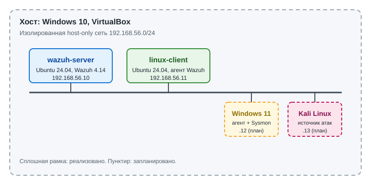

# SOC Home Lab: Wazuh

Домашняя лаборатория для практики SOC L1–L2: развёрнутый SIEM/XDR **Wazuh**, подключённые агенты, имитация действий нарушителя и разбор алертов. Каждый сценарий оформлен как короткий write-up: что сделал, что показал SIEM, как классифицировал, что бы сделал на L1 и L2.

## Архитектура стенда

| Хост | ОС | Роль | IP (host-only) |
|---|---|---|---|
| `wazuh-server` | Ubuntu Server 24.04 | Wazuh 4.14: manager, indexer, dashboard | 192.168.56.10 |
| `linux-client` | Ubuntu Server 24.04 | Наблюдаемый хост, агент Wazuh | 192.168.56.11 |
| Windows 11 LTSC | Windows 11 | Планируется: агент Wazuh + Sysmon | 192.168.56.12 |
| Kali Linux | Kali 2026.2 | Планируется: источник атак | 192.168.56.13 |

Стенд изолирован: виртуальные машины работают в host-only сети, атаки выполняются только внутри неё.

## Что реализовано

- [x] Развёртывание Wazuh (all-in-one) и подключение Linux-агента
- [x] Сбор событий из systemd journal, разбор алертов в Threat Hunting
- [x] Первый сценарий: создание локальной учётной записи
- [ ] Сценарий: неудачные входы по SSH (T1110)
- [ ] Windows-клиент, Sysmon, техники Atomic Red Team
- [ ] Собственные правила детектирования (`local_rules.xml`)
- [ ] Интеграция с дипломным проектом: автоматизация первичного анализа инцидентов

## Сценарии

| № | Сценарий | Техника MITRE ATT&CK | Правила Wazuh | Write-up |
|---|---|---|---|---|
| 1 | Создание нового пользователя в Linux | T1136, T1548.003 | 5402, 5901, 5902, 5555, 5904 | [01-linux-user-creation.md](writeups/01-linux-user-creation.md) |
| 2 | Неудачные входы по SSH | T1110 | 5760, 5503, 5715 | в работе |

## Чему научился

- Читать цепочку «журнал → декодер → правило → алерт» в Wazuh.
- Отличать служебные события (PAM-сессии, sudo) от значимых (создание учётной записи).
- Диагностировать, на каком этапе пропадают события: источник, агент, менеджер, правила, дашборд.

## Связанный проект

Дипломная работа: программный комплекс автоматизации первичного анализа и расследования инцидентов ИБ. Алерты этого стенда используются как реальные входные данные для его тестирования.

## Автор

[Имя Фамилия] · [ссылка на LinkedIn / Telegram]
