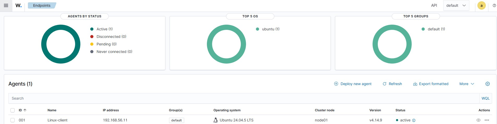
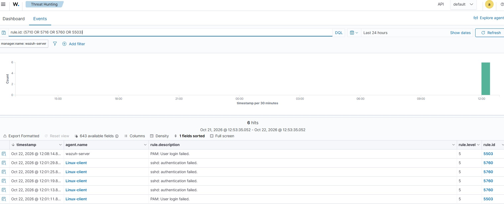
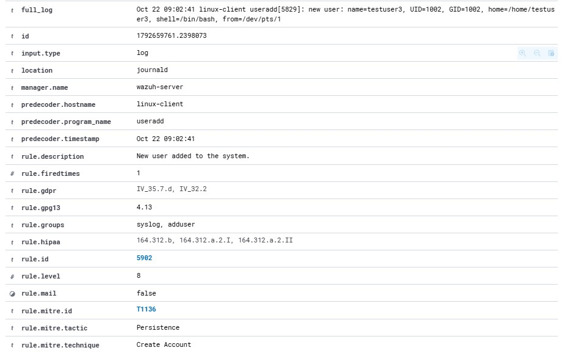
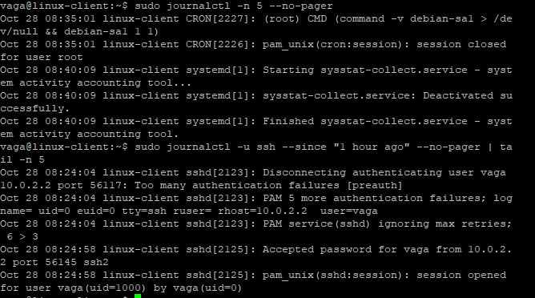

# Write-up 01: создание нового пользователя в Linux

*Автор: [Имя Фамилия] · Дата: 22.10.2026 · Стенд: Wazuh 4.14 + Ubuntu Server 24.04*

## Кратко

На `linux-client` создана новая локальная учётная запись. Wazuh зафиксировал событие несколькими правилами: создание группы и пользователя, смена пароля, изменение данных учётной записи, запуск команд через `sudo`. Действие соответствует технике MITRE ATT&CK **T1136 (Create Account)**: именно её указывает правило 5902 (тактика Persistence). По характеру действия это локальная учётная запись, то есть подтехника T1136.001.

## Окружение

- Сервер: `wazuh-server` (192.168.56.10), Ubuntu Server 24.04, Wazuh 4.14.
- Наблюдаемый хост: `linux-client` (192.168.56.11), Ubuntu Server 24.04, агент Wazuh, источник событий: systemd journal.
- Изолированная host-only сеть, доступа в интернет для атак нет.

## Сценарий

На `linux-client` от имени администратора выполнена команда создания пользователя `adduser testuser3` с заданием пароля. Цель: проверить, что действия по созданию учётной записи видны в Wazuh, и разобрать, как их различать при расследовании.

## Что показал SIEM

Threat Hunting → Events, агент `linux-client`:

| Правило | Уровень | Описание |
|---|---|---|
| 5402 | 3 | Successful sudo to ROOT executed |
| 5901 | 8 | New group added to the system |
| 5902 | 8 | New user added to the system |
| 5555 | 3 | PAM: User changed password |
| 5904 | 8 | Information from the user was changed |
| 5501 / 5502 | 3 | PAM: Login session opened / closed |

## Анализ

**Ключевые поля алерта:**

- кто выполнил действие: в самом событии 5902 пользователь не указан (видны процесс `useradd[5829]` и терминал `from=/dev/pts/1`), поэтому инициатора определяют по соседнему событию `sudo` (правило 5402) в то же время;
- какая учётная запись создана: `testuser3` (UID=1002, GID=1002, домашний каталог `/home/testuser3`, оболочка `/bin/bash`);
- время события: 09:02:41 UTC в журнале (в дашборде 12:02:41 по местному времени браузера);
- хост: `linux-client`.

**Классификация:** в лаборатории это **ожидаемая активность (true positive, инициирована мной)**. В реальной среде создание учётной записи сверяется с заявкой: есть ли согласованная задача, кто инициатор, в рабочее ли время.

**Серьёзность:** средняя. Одно событие создания пользователя не доказывает компрометацию, но в связке с другими признаками (вход из необычного места, создание ночью, сразу добавление в `sudo`) указывает на закрепление (persistence).

**Техники MITRE ATT&CK:**

- T1136: Create Account, тактика Persistence (так указано в правиле 5902); по сути это подтехника T1136.001, Local Account;
- T1548.003: Sudo and Sudo Caching (сопоставление есть в самом правиле 5402).

## Реакция

**L1:**

1. Проверить, есть ли заявка на создание учётной записи.
2. Определить, кто выполнил команду и откуда был вход (IP, время).
3. Если заявки нет, эскалировать на L2: хост, пользователь, время, имя созданной учётной записи.

**L2:**

1. Просмотреть действия созданного пользователя после создания (входы, команды, сетевые подключения).
2. Проверить, не добавлен ли он в группы `sudo` или `adm`, нет ли новых SSH-ключей и заданий cron.
3. Найти связанные события на других хостах (тот же источник входа).
4. По решению: заблокировать учётную запись, сменить пароль администратора, изолировать хост.

## Улучшение детектирования

- Повысить приоритет правила 5902 при создании пользователя вне рабочего времени.
- Добавить собственное правило: создание пользователя с последующим добавлением в `sudo` за короткое время.
- Сверять созданные учётные записи со списком согласованных.

## Что не получилось и как исправил

Сначала события из журнала в Wazuh не появлялись. Причина: клиент был клонирован из образа, после смены `machine-id` служба `systemd-journald` продолжала писать журнал в каталог со старым идентификатором, поэтому `journalctl` и агент Wazuh не находили записи (`No journal files were found`). Решение: перезапуск `systemd-journald` и перезагрузка клиента. После этого события пошли в SIEM.

После исправления `journalctl` на клиенте возвращает записи cron, systemd и sshd, то есть журнал читается, и агент Wazuh получает события.

**Вывод:** при клонировании ВМ после смены `machine-id` нужна перезагрузка, иначе агент не видит журнал.
